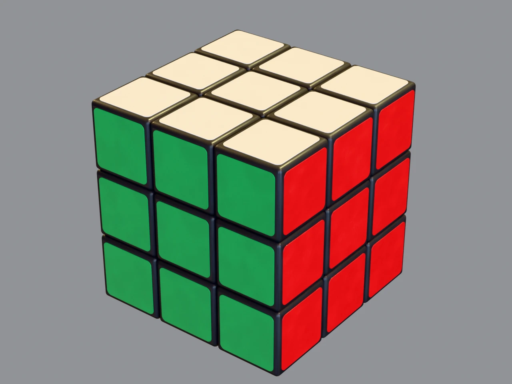
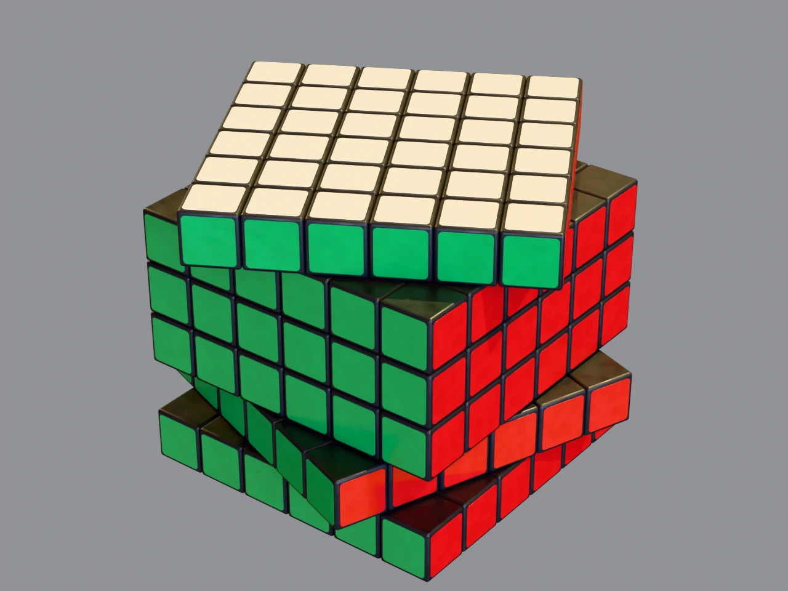
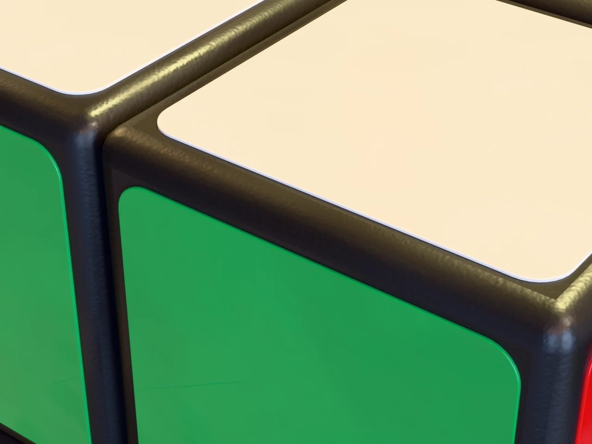

# パズルキューブ モデル（3×3 〜 6×6・10×10・15×15・20×20）

WebGL 表示用の、パーツ単位で回せるキューブモデル。部品（本体とステッカー）だけを保管しておき、任意の N×N をその場で組み立てる。

ブラウザで動かす: https://uskey512.github.io/RubiksCube/viewer/

| 3×3 | 6×6（レイヤー回転中） | 拡大 |
|---|---|---|
|  |  |  |

| ファイル | 内容 |
|---|---|
| `dist/cube_parts.gltf` | 部品集。本体 6 種・ステッカー 48 種（6 色 × 8）を 1 つずつ持つ glTF（42 KB + 形状 `cube_parts.bin` 0.4 MB） |
| `viewer/build-cube.js` | 部品集から N×N を組み立てる three.js 用モジュール |
| `textures/` | 全サイズ共通のテクスチャ（可逆 WebP、計 2.1 MB） |
| `blend/cube_NxN.blend` | 編集用 Blender ファイル（テクスチャは `textures/` を参照） |
| `previews/` | Cycles によるプレビュー画像（WebP） |
| `viewer/index.html` | three.js の動作確認用ビューア |
| `solver/` | 自動で解くソルバー（JavaScript、依存なし） |
| `scripts/` | モデル生成・プレビュー描画スクリプト |

## モデル構造

`buildCube(parts, n)` が組み立てるノードの構成（`blend/cube_NxN.blend` のシーンも同じ）:

```
Cube3x3                 extras: { size: 3, pitch: 1 }
├─ Cubie_2_2_2          extras: { grid: [2,2,2], stickers: "RUF" }
│  ├─ Cubie_2_2_2_R     extras: { face: "R", color: "red" }
│  ├─ Cubie_2_2_2_U
│  └─ Cubie_2_2_2_F
├─ Cubie_1_1_2 …
```

- 座標系は glTF 標準（+Y 上、+Z 手前）。単位は 1 パーツ = 1.0、キューブ中心が原点。
- `Cubie_x_y_z` の添字は 0〜N-1 で、位置は `(添字 - (N-1)/2)`。x: L→R、y: D→U、z: B→F。
- パーツは外から見える外殻だけ（3×3: 26、4×4: 56、5×5: 98、6×6: 152、10×10: 488、15×15: 1,178、20×20: 2,168）。
- 角・縁・中央の違いは貼るステッカーの数（3・2・1 面）だけで、本体はどれも同じ形。どの本体とステッカーの種類を使うかはサイズを種にした乱数で決まり、同じサイズなら毎回同じになる。
- 部品集とテクスチャ（計 2.5 MB）は最初に 1 回読むだけで、サイズの切り替えは組み立て直すだけ（20×20 で 20 ms 程度）。
- 20×20 は約 170 万三角形。
- 面と色: U 白 / D 黄 / F 緑 / B 青 / R 赤 / L 橙。
- `stickers` は揃った状態での面の向き。回した後の実際の向きはノードの回転から求める。
- 名前と `userData` は glTF の extras と同じ形で持つ。

## three.js でレイヤーを回す

キューブ直下のパーツを、位置で選んでピボットに付け替えて回し、終わったら戻して格子に丸める。

```js
import { partsFrom, buildCube } from './viewer/build-cube.js';

const parts = partsFrom(await new GLTFLoader().loadAsync('dist/cube_parts.gltf'));  // .bin とテクスチャも相対パスで読まれる
const cube = buildCube(parts, 3);
scene.add(cube);
const cubies = [...cube.children];  // 回すと cube.children が入れ替わるのでコピーを持つ

function turnLayer(axis, layer, quarter) {      // axis: 'x'|'y'|'z', layer: 0..N-1, quarter: ±1
  const coord = layer - (N - 1) / 2;
  const pivot = new THREE.Object3D();
  cube.add(pivot);
  const members = cubies.filter((c) => Math.abs(c.position[axis] - coord) < 0.25);
  members.forEach((c) => pivot.attach(c));
  pivot.rotation[axis] = quarter * Math.PI / 2;  // 実際はここをアニメーションさせる
  members.forEach((c) => { cube.attach(c); snap(c); });
  cube.remove(pivot);
}
```

丸め処理（`snap`）とアニメーションの完全な実装は `viewer/index.html` にある。回転を繰り返すと浮動小数の誤差がたまるので、毎回の丸めは必須。

ビューアは、同じジオメトリとマテリアルを使うメッシュを `InstancedMesh` にまとめて描画している。組み立てたノードは非表示のままシーンに残して上のように回し、動いたフレームだけワールド行列をインスタンスに写す。メッシュごとに描くと 20×20 で 4,568 draw calls になるところが、どのサイズでも 54 以下に収まる。

GitHub Pages では main ブランチのルートをそのまま配信している（`.nojekyll` で Jekyll の変換を止め、ルートの `index.html` はビューアへ転送するだけ）。手元でのビューアの起動（リポジトリのルートで実行。three.js は CDN から読み込む）:

```bash
python3 -m http.server 8765
```

起動後に `http://localhost:8765/viewer/` を開く。U D L R F B キーで外側の面、Shift で逆回転、ボタンでサイズ切替・シャッフル・自動で解く（コンピューター式 / 人の手順）。

## 自動で解く

`solver/` は今の盤面から解法の手順を計算する。手で回した途中の状態など、どんな状態からでも解ける。解き方は 2 通りあり、ビューアではボタンで選ぶ。再生中は今どの段階かが表示される。

| サイズ | コンピューター式（平均 / 最大） | 人の手順（平均 / 最大） |
|---|---|---|
| 3×3 | 21 / 23 | 123 / 160 |
| 4×4 | 199 / 232 | 215 / 263 |
| 5×5 | 270 / 311 | 338 / 397 |
| 6×6 | 521 / 589 | 519 / 616 |
| 10×10 | 1,591 / 1,653 | 2,349 / 2,487 |
| 15×15 | 3,658 / 3,816 | 5,631 / 5,706 |
| 20×20 | 6,775 / 6,885 | 10,444 / 10,629 |

手数は 3×3〜6×6 が各 200 回、10×10 以上が各 10 回のランダムな状態で計測した値。1 回の計算は数ミリ秒〜1 秒程度で、サイズごとの初回は表の準備が加わる（20×20 で 3〜4 秒ほど）。

### コンピューター式

3×3 は Kociemba の二段階法、4×4 以上はリダクション法で、少ない手数を優先する。リダクション法の手順:

1. コーナー（奇数サイズは中央のエッジとセンターも）を 3×3 として Kociemba で揃える
2. エッジを軌道（入れ替わりうる駒の組）ごとに揃える。3 つの駒だけを入れ替える手順（3-cycle）を使い、偶数サイズ特有のパリティはスライスの 1/4 回転で直す
3. センターを軌道ごとに 3-cycle で揃える

3-cycle は交換子を探索して自動生成し、本当に 3 駒しか動かないことをシミュレーションで確認してから使う。手順を書き写していないので、サイズが増えても同じコードで動く。

### 人の手順

人が実際に使う段階とアルゴリズムで解く。手順書どおりに当てはめる段階では、キューブを持ち替える代わりに、同じアルゴリズムを 4 方向のどれかに置き換えて使う。

4×4 以上はまずセンターとエッジを作り、3×3 と同じ状態にする。7×7 までは下の 1・2 のとおりスライスを使った手を探す。8×8 以上は毎回試す手が多すぎるため、センターもペアリングも同じ順番のまま 3 駒を入れ替える交換子で進める。

1. **センター**: 1 面目 → 反対の面 → 3 面目 → 4 面目 → 残り 2 面の順。「スライス・面・スライス戻し」のような短い手で、そろえた面を崩さずに 1 つでも多く集まる手を選ぶ。残り 2 面の終盤は 3 駒だけ入れ替える交換子を使う
2. **エッジのペアリング**: スライスで同じ色のウィングを並べ、`R U R' F R' F' R` で上段へ逃がしてからスライスを戻す。最後の数本は交換子で仕上げる。5×5 以上でウィングの偶奇が合わないときは「エッジのパリティ」として `r2 B2 U2 l U2 r' U2 r U2 F2 r F2 l' B2 r2` を 1 層ぶんだけで回す
3. **3×3 として解く**: 外側の面だけを回して下の表の手順で解く。偶数サイズでは、上面のクロスで向きの合わないエッジが 1 本残ったら OLL パリティ（同じ手順を内側の層すべてで）、上段エッジが 2 本だけ入れ替わっていたら PLL パリティ（`r2 U2 r2 Uw2 r2 u2`）を、その段階に来た時点で入れる

3×3 は初心者向けの層ごとの解き方。最後の層をビューアのカメラから見える U 面で解くため、最初の層は D 面に作る。

| 段階 | 使う手順 |
|---|---|
| 下面のクロス | 下面のエッジを 1 本ずつ、入れやすいものから最短手数で |
| 1 段目のコーナー | コーナーを真上に持ってきて `R U R' U'` を繰り返す |
| 2 段目のエッジ | `U R U' R' U' F' U F` / `U' L' U L U F U' F'` |
| 上面のクロス | `F R U R' U' F'` を 1〜3 回 |
| 上面の色をそろえる | `R U R' U R U2 R'`（スーン）を 1〜3 回 |
| 上段コーナーの位置 | `R' F R' B2 R F' R' B2 R2`（A パーム） |
| 上段エッジの位置 | `R U' R U R U R U' R' U' R2`（U パーム） |

| ファイル | 内容 |
|---|---|
| `solver/cube.js` | NxN の盤面モデル（座標系と回転の向きはビューアの `turn()` と同じ） |
| `solver/kociemba.js` | 3×3 の二段階法 |
| `solver/solve.js` | コンピューター式の本体 `solveCube(n, state)` |
| `solver/human.js` | 人の手順の本体 `solveHuman(n, state)`（3×3 以上） |
| `solver/worker.js` | 画面を止めないための Web Worker |
| `solver/test.mjs` | ランダムな状態を解いて検証するテスト |

使い方（盤面の読み取りは `viewer/index.html` の `readState()` を参照）:

```js
const worker = new Worker('solver/worker.js', { type: 'module' });
worker.onmessage = ({ data }) => {
  for (const { axis, layer, q } of data.moves) turnLayer('xyz'[axis], layer, q);  // q: 1, -1, 2（90° 単位）
};
worker.postMessage({ n: 4, state, method: 'human' });  // state: 6n² 個の色 ID（U R F D L B 順の面ごと）、method: 'computer' | 'human'
```

テスト（両方の解き方を検証する）:

```bash
node solver/test.mjs 200
```

## 質感

glTF 標準の PBR（metallic-roughness）で構成している。使っている拡張はテクスチャを WebP で持つための `EXT_texture_webp` だけで、three.js・Babylon.js・model-viewer などの主要なローダーはそのまま読める。

テクスチャは可逆の WebP にしている。非可逆にすると 1/10 以下になるが、ノーマルマップの凹凸の振れ幅（標準偏差で 1〜2 階調）と同じくらいの誤差が出て、拡大したときの質感が崩れるため。

- **本体**: 黒い成形プラスチック。細かい肌理と浅い擦り傷をノーマルマップに、ムラと傷のつや変化をラフネスに入れている。
- **ステッカー**: 角丸で厚みのあるビニール。縁は丸めてあり、拡大するとハイライトが乗る。わずかなうねり・細かい傷・指紋状のつやムラを入れている。色は共通テクスチャ × マテリアルごとの `baseColorFactor` で決まり、ランタイムでも差し替えやすい。
- テクスチャはシームレスで、ステッカーと本体のメッシュは UV のずれた複数のバリエーションを使い回しているため、同じ傷が並んで見えることはない。
- 想定するレンダラー設定: 環境マップあり（例: `RoomEnvironment` + `PMREMGenerator`）、`NeutralToneMapping`。

## 再生成

```bash
blender -b --factory-startup -P scripts/build_cubes.py -- --sizes 3 4 5 6 10 15 20
```

部品集（`dist/cube_parts.gltf`・`.bin`）と、指定したサイズの `.blend` を書き出す。`--regen-textures` でテクスチャも作り直す。`.blend` は 2 以上の任意のサイズを指定できる（ビューアの組み立ては部品集だけで済む）。寸法・色・テクスチャの強さはスクリプト冒頭の定数と `generate_textures()` で調整する。

プレビュー画像の再描画:

```bash
blender -b --factory-startup -P scripts/render_previews.py -- --sizes 3 4 5 6
```
